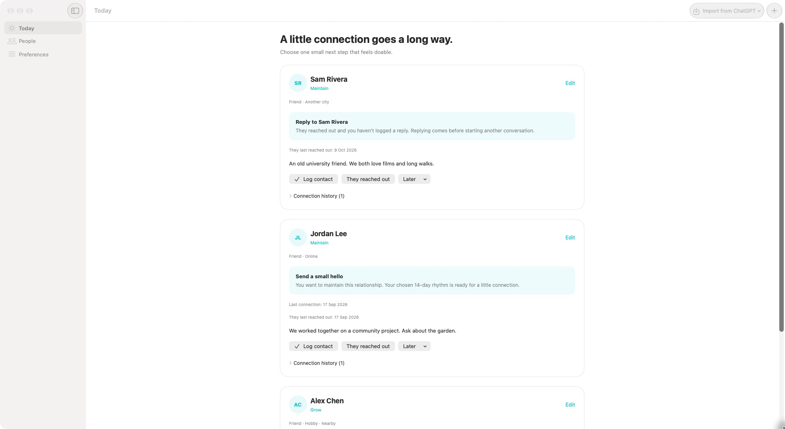

# Keep Close

Keep Close exists because it is possible to value people deeply and still drift away from them. It records what you actually share with someone, then offers one grounded way back in — an evening of board games, a walk, a call — instead of counting the days since you last spoke.

A native SwiftUI app for Mac, iPhone and iPad, with a CLI your agents can use.



- Keep overlapping relationship labels, shared contexts and notes without reducing someone to a score.
- Choose whether to grow, maintain, give space, or stay undecided about each relationship.
- Record shared interests, memories and ways of connecting; suggestions are built from those, not from a stopwatch.
- Import people and context from ChatGPT or Claude, then send your corrections back and bring in new context.
- Say what was useful, set an idea aside, or log what really happened. Ignoring a suggestion means nothing.
- Optional Face ID/Touch ID/device authentication and private reminder previews.

**There are no streaks, scores, completion percentages or leaderboards, and nothing becomes overdue.**
A relationship you have not contacted for a year is not a failure; it may simply be a relationship you
have not needed to maintain. Keep Close is designed to be satisfying when there is nothing to do.

**Status:** early version. Data is saved locally; optional **Device sync** exchanges shared records with your paired Mac/iPhone on the same network. The screenshot uses fictional data.

## Install on Mac

Requires macOS 14 or later. Release downloads support Apple Silicon and Intel.

1. Open [GitHub Releases](https://github.com/slaymish/KeepClose/releases/latest).
2. Download `KeepClose-macOS.zip`, unzip it, and move **Keep Close.app** to **Applications**.
3. Open Keep Close. Add a person, or choose **Import from ChatGPT** and copy the prompt into your chat. Review the returned JSON before applying it. Suggestions work best once you have recorded a few shared interests or memories.
4. Set a reminder time in **Preferences**. For private named previews, set macOS Notifications → Keep Close → Show previews → **When Unlocked**.

Published Mac releases are Developer ID signed and notarized. Sparkle checks for signed updates, offers automatic updates through its standard settings, and provides **Keep Close → Check for Updates…**. If there is no release yet, build from source below; binary publication requires the maintainer's Apple distribution credentials.

### Install the agent CLI

Download `keepclose-macOS.zip` from the same release, unzip it, then run:

```sh
mkdir -p "$HOME/.local/bin"
install -m 755 /path/to/downloaded/keepclose "$HOME/.local/bin/keepclose"
"$HOME/.local/bin/keepclose" help
```

Add `$HOME/.local/bin` to your shell's `PATH`, or give your agent the full executable path. The CLI reads the same Mac data as the app. It supports listing, creating/editing people, logging contact, suggestions, reminders and imports. No MCP server or account connection is required. CLI releases are signed/notarized; updating the Mac app does not replace a separately installed CLI.

## Build from source / install on iPhone

Install Xcode with Swift 6 support. Install [XcodeGen](https://github.com/yonaskolb/XcodeGen) if you want to regenerate the project (`brew install xcodegen`). Then:

```sh
git clone https://github.com/slaymish/KeepClose.git
cd KeepClose
open SocialManager.xcodeproj
```

Choose the **SocialManager** scheme and **My Mac**, an iPhone simulator, or your connected iPhone. Choose your Apple development team in **Signing & Capabilities**, then Run. iPhone/iPad updates currently come through Xcode; no App Store/TestFlight release pipeline is configured.

For the Mac, `scripts/run-mac.sh` builds, signs all nested components with an existing valid Apple Development identity, builds the CLI and launches the app. Set `KEEPCLOSE_SIGNING_IDENTITY` to choose an identity. The script does not create Apple certificates. Unsigned builds check compilation but don't reliably validate notifications.

For agents working from source, use `scripts/keepclose help`; it builds the CLI incrementally. `project.yml` owns the Xcode configuration. Sparkle 2.10.0 is pinned and linked only on macOS; the core/CLI Swift package has no external dependencies. Debug builds do not run the updater.

## Relationships, context and suggestions

Setup uses selectable categories rather than a single relationship column:

- Multiple relationship labels: Friend, Family, Colleague, Partner, Acquaintance, or your own.
- Multiple shared contexts: Work, Flatmate, Online, Hobby, Nearby, Another city, or your own.
- An intention: Grow, Maintain, Give more space, or Unsure.
- Notes to preserve the nuance, preferred contact method, and an optional custom rhythm.

Alongside those, each person can hold **recorded context**: shared interests, things worth remembering,
ways of connecting, and recurring patterns such as a regular game night. Suggestions are built from that
context, so a prompt can say *"Another board game evening?"* rather than *"You haven't contacted Ryan in
30 days."* Anything you record yourself is marked as yours; anything an agent suggests stays labelled as
unconfirmed until you edit it.

Today offers up to three grounded opportunities. When nobody is ready it says so plainly and, if it has
anything to work with, quietly lists a few people whose recorded context is available — an invitation, not
a to-do list. The CLI returns every ready opportunity.

Contact logs distinguish **I reached out**, **They reached out**, **We caught up**, **I replied**, and
**Everyday contact**. Catch-ups optionally record who initiated. Incoming messages create a reply
suggestion; a reply or catch-up closes earlier incoming messages. An incoming item can also be marked
"No reply needed" without pretending a conversation happened. Backdated incoming logs are matched against
already-recorded later replies/catch-ups.

Rules are deliberately inspectable:

- An outstanding incoming message suggests replying, even if your intention is to give more space.
- A sent message, reply, or meaningful catch-up starts a new rhythm. Everyday contact in passing does not.
- Three recent recorded contacts initiated by them can suggest taking the initiative once your rhythm is ready. An incoming message followed by its catch-up counts as one initiation.
- Two consecutive outreach attempts with no later logged reply or conversation suggest giving them room. This is an inference from your logs, not evidence that they ignored you.
- Grow favours time together and shared activities; Maintain favours a message, a call or a shared interest; Unsure suggests choosing a direction. Give more space and Pause suppress proactive ideas entirely.
- Recorded ideas are offered when they are ready. An idea with a stated cadence ("roughly every 90 days") waits that long after you last did it; one without a cadence is available straight away.
- Postponing moves the next prompt. It is not counted anywhere.

Editable starting rhythms are 14 days, 7 for a Partner label, or 30 for an Acquaintance label.
Work/Flatmate/Nearby contexts allow at least 21 days between intentional check-ins. Grow halves this
starting rhythm (minimum 3 days). Give more space retains a 45-day or longer rhythm but produces no
proactive suggestions. These are product defaults, not measures of relationship health. Custom rhythms
take precedence and are never automatically adjusted. A rhythm decides when a prompt may appear, never
what you should say or whether you should reach out.

### Feedback works in one direction only

There is no engagement tracking. The app records a signal only when you give one deliberately:

- **Useful** makes that idea more likely to be offered first.
- **I did this** moves that idea's cadence clock.
- **Not for me** sets an idea aside. It is never offered again, and later imports cannot bring it back.
- **Later** postpones the next prompt.

Ignoring a suggestion records nothing at all. There is no penalty, no escalation, and no inference from
non-use. Marking a suggestion useful does not postpone it either — appreciation is not an action.

The app opens your configured contact app; you send the message yourself. Opening it never logs contact.
Suggestions use manually logged history and recorded context; no message or contact-account access is
involved.

An optional daily local notification at an adjustable time (6 pm by default) invites you to check in, even
if nobody is due. Names are optional and only scheduled when the OS uses When Unlocked previews; see
privacy details below.

## Limits and next decisions

On Mac, app and CLI share `~/Library/Application Support/KeepClose`. The local Mac build is not sandboxed, allowing agents to access the same data; iOS retains its app sandbox. Files are saved atomically with a shared lock. The app refreshes external changes every two seconds and rejects stale editor saves. Each device keeps a separate local copy. Enable Device sync in Preferences to pair them. Existing records merge by stable IDs; conflicting offline edits require review, and independently created duplicates remain separate people. Keep both apps open and the Mac awake on a reachable local network. See [device-sync details](docs/NATIVE_LIBRARY.md).

Keep Close reduces the effort of choosing and starting. It cannot guarantee follow-through, and it does not try to. It deliberately avoids overdue scores, streaks and increasing alerts.

Possible next work: iCloud sync, contact import with permission, widgets, a shared "connection session" for a group, data export and undo for contact logs, and learning more from explicit feedback than a single local ordering. The current version supports manual data entry, agent JSON imports/updates and manual contact logging. Contact history and person deletion have no undo yet; deletion asks for confirmation.

Suggestion quality depends on what has been recorded. A person with no interests, memories or ideas can
only be offered a generic hello; that is intentional, and the interface invites you to add context rather
than inventing it.

## Agent CLI

Use `scripts/keepclose help` for the full command reference. All command results are JSON; errors go to stderr with a nonzero exit status. No MCP setup is required.

```
scripts/keepclose list
scripts/keepclose due
scripts/keepclose add --name 'Alex' --days 14 --method message
scripts/keepclose update PERSON_UUID --types 'Friend,Colleague' --contexts 'Work,Online' --intention grow
scripts/keepclose update PERSON_UUID --notes 'Ask about their new job'
scripts/keepclose suggestions
scripts/keepclose suggest PERSON_UUID
scripts/keepclose log PERSON_UUID --kind incoming --note 'They sent a hello'
scripts/keepclose log PERSON_UUID --kind reply --note 'Replied'
scripts/keepclose snooze PERSON_UUID --days 3
scripts/keepclose pause PERSON_UUID
scripts/keepclose resume PERSON_UUID
scripts/keepclose context PERSON_UUID
scripts/keepclose interest PERSON_UUID --add --name 'Board games' --detail 'Owns a stack'
scripts/keepclose memory PERSON_UUID --add --text 'The walk along the canal we both enjoyed'
scripts/keepclose idea PERSON_UUID --add --activity 'an evening of board games' \
  --kind sharedActivity --timing weekend --reason 'You both enjoy them'
scripts/keepclose ritual PERSON_UUID --add --title 'Thursday game night' --days 7
scripts/keepclose useful PERSON_UUID --idea IDEA_UUID
scripts/keepclose pass PERSON_UUID --idea IDEA_UUID
scripts/keepclose idea PERSON_UUID --dismiss --idea IDEA_UUID
scripts/keepclose reminders on --time 18:00 --launch
scripts/keepclose reminders
```

Also supports `show`, `resolve ID --entry ENTRY_UUID`, `open`, `delete ID --yes`, `reminders off` and `path`, plus `idea --edit/--restore/--remove`, `memory --edit/--forget` and `interest --edit/--remove`. `open` never sends or logs contact. CLI writes reload the latest data under a lock and change only the requested fields. Use `--data-dir PATH` for an isolated dataset. Mac CLI access does not give agents access to iPhone data.

Context commands record where information came from (`--source me|them|memory|agent|unsure`) and how well it
is known (`--confidence known|unsure|suggested`). An agent should never mark its own inference as `known`.
`pass ID --idea IDEA_UUID` sets an idea aside so it will not be offered again and imports will not revive it;
`useful ID --idea IDEA_UUID` notes that a suggestion helped. Neither logs contact.

Reminders run through the app, which owns the OS notification permission. The CLI stores the requested schedule; `reminders` reports both the request and the last actual status reported by the app. The app must run at least once to apply changes. Once the OS has scheduled a reminder, the app need not stay open for delivery. Scheduling status does not guarantee a banner is displayed: system settings and Focus can affect presentation.

## Development checks

Run `swift test` for suggestion and opportunity rules, recorded-context merging, import de-duplication and preservation, legacy migration, transactions, data preservation and reminder settings. Run `python3 scripts/test-cli.py` for CLI lifecycle checks, context commands, version-1 and version-2 imports, validation and 30 concurrent process writes against a temporary dataset. Application builds are checked with:

```
xcodebuild -project SocialManager.xcodeproj -scheme SocialManager -destination 'platform=macOS' CODE_SIGNING_ALLOWED=NO build
xcodebuild -project SocialManager.xcodeproj -scheme SocialManager -destination 'generic/platform=iOS Simulator' CODE_SIGNING_ALLOWED=NO build
```

On upgrade, original labels become relationship categories, original notes remain notes, and existing rhythms remain custom. Legacy history is preserved and excluded from inferences about unanswered messages because the first version did not track incoming replies. Recorded context, ideas and feedback are new optional fields, so existing files load unchanged; an existing intention counts as a deliberate choice and will not be overwritten by an import.

## Import from ChatGPT or Claude

The toolbar's **Import from ChatGPT** menu offers ChatGPT and Claude. Choose a provider to open the import screen and copy a prompt. Paste it into a chat with that agent. The app does not connect to either account or launch chats automatically.

The prompt asks for real people identified from memories and conversation context the agent can actually access, with multiple relationship labels, shared contexts and useful notes. It also asks for grounded connection ideas: at most three per person, each tied to something the agent can point to, with the reason it might be meaningful and an honest confidence level. Unknown intentions are left unset; new records start as Unsure. No contact history, contact details or shared experiences are fabricated.

The grounding rules are part of the prompt rather than an afterthought: no invented shared history, no guesses about someone else's availability or willingness, no contact details, no pressure on someone who may want space, and no suggestions whose only justification is elapsed time. Anything the agent is unsure about must be marked `unsure`; anything it generated as an idea rather than recalled must be marked `suggested`. If a confidence level is omitted, Keep Close treats the context as a suggestion, not a fact.

- Local agents with terminal access get the CLI path in the prompt. They can preview and apply a batch directly. The running Mac app refreshes after import.
- Chats without local terminal access return a `keepclose-import.json` file or JSON code block. Choose the file or paste the JSON in the app, inspect the preview, select the people to include, and import.
- On iPhone, the prompt uses the file/paste route. Imported records and agent-update checkpoints also reach your paired device when Device sync is enabled. OS permissions and app locks remain per device.

CLI commands:

```
scripts/keepclose import-prompt --source chatgpt
scripts/keepclose import-prompt --source claude
scripts/keepclose import /private/path/keepclose-import.json --dry-run
scripts/keepclose import /private/path/keepclose-import.json --apply
```

Import defaults to preview, with JSON output. `--apply` validates the whole batch, locks/reloads the latest data, saves a private backup of existing storage and writes atomically. The app rejects an outdated preview and lets you refresh it. Validation errors never partially import a batch.

Version 1 is still accepted. Version 2 adds an optional `context` object:

```json
{
  "version": 2,
  "source": "chatgpt",
  "people": [
    {
      "name": "Example person",
      "types": ["Friend", "Colleague"],
      "contexts": ["Work"],
      "notes": "Useful relationship context.",
      "context": {
        "source": "memory",
        "confidence": "unsure",
        "memories": ["An evening we both enjoyed, as I remember it."],
        "interests": [{ "name": "Board games", "detail": "Mentioned once" }],
        "ideas": [
          {
            "activity": "an evening of board games",
            "kind": "sharedActivity",
            "reminder": "Another board game evening?",
            "reason": "You both enjoy them.",
            "timing": "weekend",
            "cadenceDays": 14,
            "source": "memory",
            "confidence": "unsure"
          }
        ],
        "rituals": [{ "title": "Thursday game night", "note": "A standing invitation", "days": 7 }]
      }
    }
  ]
}
```

Optional person fields: `id` (an existing UUID), `intention`, `method`, `address`, `rhythmDays`, and `context` (version 2 only). Intention uses grow/maintain/space/unsure; method uses message/call/email/in-person.

Inside `context`: `source` (me/them/memory/agent/unsure — where the information came from) and `confidence` (known/unsure/suggested) apply to everything in the object unless an idea, interest or ritual overrides them. `memories` are short recollections; `interests` are topics or shared ground; `ideas` are ways of connecting; `rituals` are recurring patterns. Each idea accepts `activity` (required), `reminder`, `reason`, `kind` (sharedActivity/async/call/ritual/visit/gesture/conversation), `timing` (anytime/weekday/evening/weekend/freeTime), `occasions`, `cadenceDays` (1–365), `source` and `confidence`. Each ritual accepts `title` (required), `note`, `days`, `source` and `confidence`.

No other fields are accepted, and unknown keys anywhere in a record are rejected before anything is written. JSON code fences are supported for pasted replies. Limits: 2 MB, 1,000 people per batch, 20,000 characters of notes per person, and per person 40 memories, 40 interests, 40 ideas and 20 rituals.

Duplicates match by existing UUID when supplied, otherwise by normalized name (case, whitespace and accents). Context duplicates match on kind plus the words of the text, ignoring punctuation, so "An evening of board games" and "an evening of board games!" are one idea rather than two. Multiple matching people require an explicit UUID; multiple import records targeting one person are rejected. Matching does not guess nicknames or identities.

Merges add categories, new notes and new context, fill empty contact details, and retain existing names, intentions, rhythms, contact history, pause/snooze settings and populated contact details. An explicit intention in an import fills a record still marked Unsure, but never overrides a choice you have made. Your own wording for an idea always wins over an agent's rewrite, while provenance records that both sources contributed. An idea you set aside is never revived by a later import, even when it is reworded. Repeated identical imports become no-ops, and an unchanged batch writes no backup.

The import screen previews every new person, merge and idea. Unchecking a person excludes them from this
batch; unchecking a suggested idea leaves it out. To reject an idea permanently — so no later import can
offer it again — use **Not for me** in the app or `pass ID --idea IDEA_UUID` in the CLI.

## App lock and notification privacy

Preferences now includes **Require authentication to open Keep Close**. Enabling or disabling it requires successful Apple device-owner authentication. Unlock uses Face ID or Touch ID where supported, with the device passcode or Mac login password as the system fallback. No separate app password is collected or stored. The lock preference is saved atomically in the device's local app settings; unreadable settings fail closed. Lock is off until you enable it and is configured separately on each device.

When enabled, the app starts locked, hides its UI when inactive, and re-locks on leaving/backgrounding, device data protection, Mac sleep or session changes. Authentication completed after a lock/background event is discarded. **Lock now** is also available. Locking closes unsaved editors and import previews. The app lock protects the UI; it does not encrypt or revoke local agent access to the shared JSON files or backups. The CLI remains available to your agents.

For reminders, the title is always generic. The category's hidden preview says **“Someone is ready for a little connection.”** Names appear only in the notification body, and the app only includes them when the OS reports **Show Previews → When Unlocked**. Set that option explicitly for Keep Close in system Notifications settings. If previews are Always, Never, unknown, or the in-app names toggle is off, reminders are scheduled with generic wording instead. The app cannot change the OS preview preference itself; the preferences screen includes a shortcut and reports the detected setting.

The OS controls rendering of already-scheduled notifications. Keep **When Unlocked** selected while named notifications are pending. If you change that OS setting while the app is closed, it cannot rewrite pending notifications until it runs again. Turning names off in the app reschedules the reminder generically and clears the previous delivered reminder. Privacy settings are rechecked when the app becomes active and periodically while running. Reminder names are a snapshot of up to three suggested people for the next scheduled check-in, refreshed when the app sees relationship changes.

CLI notification preference:

```
scripts/keepclose reminders on --names when-unlocked
scripts/keepclose reminders on --names never
```

See Apple's [device authentication policy](https://developer.apple.com/documentation/localauthentication/lapolicy/deviceownerauthentication), [notification preview setting](https://developer.apple.com/documentation/usernotifications/unnotificationsettings/showpreviewssetting) and [hidden preview placeholder](https://developer.apple.com/documentation/usernotifications/unnotificationcategory/hiddenpreviewsbodyplaceholder).


## Updating from ChatGPT or Claude

After an import, that provider's menu item becomes **Update from ChatGPT/Claude**. The copied prompt includes current people (stable UUIDs, names, categories, preferences, notes, contact history, recorded interests, memories, ideas and the ideas you have set aside), changes since that provider's last applied batch, previous values for edited records, and deleted records. Only share this prompt with a chat you want to have that information; nothing is sent anywhere until you copy it yourself.

The agent is asked to reconcile its accessible memory with your app corrections, then return new people or useful context. A name correction stays attached to the same UUID; imports never overwrite your current name or preferences. If the agent cannot save memory, it must report that and give you corrections to save manually. Copying a prompt does not connect to an account, run an agent or change memory by itself.

Set-aside ideas are shared with the agent as `"dismissed": true` records so it can avoid repeating them without
reasoning about why. Preview and apply the returned JSON as before. An empty `people` array is valid after a
memory-only update. Each successfully applied batch establishes a checkpoint for that provider; copying the prompt does not. Checkpoints include app and CLI changes, not just manual edits. Older imports have no historical checkpoint, so the first update shares the current records without claiming to reconstruct past edits. Checkpoints and backups stay outside the repository.

From a local agent:

```sh
scripts/keepclose import-prompt --source chatgpt
scripts/keepclose import /private/path/keepclose-import.json --dry-run
scripts/keepclose import /private/path/keepclose-import.json --apply
```

## Releases

Tags such as `v0.1.0` run tests and publish signed/notarized universal Mac app and CLI downloads plus a signed Sparkle feed. Apple distribution secrets must be configured first. Read [the release guide](docs/RELEASING.md) or ask an agent to use the project's [release skill](.agents/skills/release/SKILL.md). User-facing changes live in [CHANGELOG.md](CHANGELOG.md).
